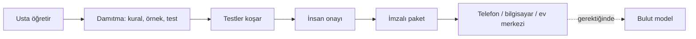

# Skillpack'e Giriş

> Bu belge, projenin ne olduğunu, neden var olduğunu ve nereye gittiğini ilk kez okuyan biri için anlatır. Teknik ayrıntılar için [teknik taslak](../TEKNIK_PROJE.md), son tartışmalar için [Proje devamı](PROJE_DEVAMI.md) belgesine bakın.

## Kısaca

Skillpack (Yerel Beceri Paketi), yapay zekaya **dar ama güvenilir beceriler** kazandırmak için açık bir standarttır. Bir usta bir işi bir kez öğretir. Sistem bu bilgiyi kurallara, örneklere ve testlere dönüştürür, bir insan onaylar, ve sonuç imzalı, taşınabilir bir paket olarak telefona, bilgisayara ya da ev cihazlarına yüklenebilir.

Standart, [Agent Skills](https://agentskills.io) biçimini (`SKILL.md`) temel alır ve ona şunları ekler:

- imza ve geri çağırma (revocation),
- insan onayı ve test zorunluluğu,
- eşler arası (P2P) dağıtım,
- cihaz, yerel ve bulut arasında yönlendirme.

Proje ticari değildir ve açık lisansla geliştirilir.

## Hangi sorunu çözüyor?

### 1. Küçük modeller çok hata yapıyor

Telefona ya da dizüstü bilgisayara sığan modeller (1–14 milyar parametre) genel sorularda zayıf kalıyor. Kendi denememizde 7B bir model, öncelikli 5 kuralı 20 denemenin 13'ünde doğru uyguladı. Aynı kuralları uygulayan basit bir betik ise 20'de 20 yaptı.

Buradan projenin temel kuralı çıktı: **karar betikte, açıklama modelde.** Model ne yapılacağına karar vermez, betik karar verir. Model sadece sonucu insan diliyle anlatır ve belirsiz durumda kullanıcıya sorar.

### 2. Bulut modeller pahalı ve her şeyi göremiyor

Bulut modeller güçlü ama her iş için onlara gitmek token harcar, internet ister ve verinin dışarı çıkması demektir. Üstelik bulut, cihazın kendi bilgilerini göremez: telefonun pil durumu, bilgisayarın işlemci yükü ya da buzdolabının sıcaklığı gibi.

Yerelin avantajı zeka değil, erişimdir. Yerel taraf cihaza dokunur, buluta sadece özet gönderir.

### 3. Beceriler dağınık ve güvenilmez

Bugün bir modele beceri kazandırmanın yolu genelde bir istem (prompt) dosyasıdır. Kimin yazdığı, test edilip edilmediği ve hatalı çıkarsa nasıl geri alınacağı belli değildir. Skillpack her pakete imza, test ve onay zinciri ekler.

## Nasıl çalışır?



1. **Öğretme:** Bir usta işi anlatır ya da gösterir.
2. **Damıtma:** Sistem bunu kurallara, örneklere ve testlere dönüştürür. Bulut model burada öğretmen rolündedir: paketi yazar, yerel taraf kullanır.
3. **Test ve onay:** Paket testlerden geçer, bir insan onaylar.
4. **Paketleme:** Paket imzalanır. Hatalı çıkarsa geri çağrılabilir.
5. **Kullanım:** Cihazda kural motoru ve (varsa) küçük model paketi çalıştırır. Cevabı olmayan sorular buluta gider, bulut ulaşılamazsa yerel kurallar devreye girer.

Paketin içeriği (SKILL.md, kurallar, örnekler, testler, istemler) **İngilizce** yazılır, çünkü küçük modeller İngilizceyi en iyi anlıyor. Kullanıcıya görünen dil ise serbesttir.

## Yerel ve bulut nasıl işbirliği yapar?

Üç yol var:

1. **Bulut denetler:** Yerel cevap verir, bulut kontrol eder.
2. **Bulut paket yazar (önerilen):** Bulut kuralları, örnekleri ve testleri üretir. Yerel bunları sonsuza dek bedavaya kullanır.
3. **Bulut yerel modeli eğitir:** Model damıtma. Sağlayıcı şartları kontrol edilmeli, bazıları çıktılarıyla model eğitmeyi kısıtlıyor.

Orta segment bir telefon için yaptığımız **sentetik** bir simülasyonda (1.000 sorgu, varsayımlara dayalı) paket ve bulut desteğiyle doğruluk %68,4'ten %92,9'a çıktı, bulut çağrıları %23'ten %13,6'ya indi. Bunlar ölçüm değil tahmindir. Gerçek cihazda doğrulanmalıdır.

Ayrıca her pakete bir token bütçesi önerilmektedir:

```yaml
budget:
  skill_max_tokens: 2000
  local_max_output: 300
  cloud_max_tokens_per_day: 5000
  on_exceed: ask_user
```

## Nerede çalışır?

| Katman | Bugün ne mümkün | Paket ne yapar |
|---|---|---|
| Telefon | 1–4B modeller; çoğu uygulamada yerel model yok, kural motoru yeterli | Pil, depolama, ısı gibi cihaz bilgilerini okur ve cevaplar |
| Dizüstü / masaüstü | 7–14B modeller rahat çalışır | Sistem ölçümü, oyun ve iş performansı için sadece resmî ve geri alınabilir ayarlar |
| Ev merkezi | Home Assistant + Ollama (mini PC ya da Raspberry Pi 5) | Ev cihazlarını izler, kuralı çalıştırır, buluta sadece özet gönderir |
| Beyaz eşya | Cihazda LLM yok, sadece mikrodenetleyici | Kural cihazda, aklı ev merkezinde |

32B bir modelin orta segment telefonlara inmesi için tahminimiz 2029–31, amiral gemisi telefonlar için 2027–28. Bu bir tahmindir.

## Hedef ürün: dört katman

1. **Arayüz:** Home Assistant uygulaması ya da web.
2. **Sesli komut:** openWakeWord, Whisper ve Piper (Home Assistant Assist).
3. **Yüklenebilir beceriler:** İmzalı, onaylı, geri çağrılabilir paketler. Projenin asıl katkısı bu katman.
4. **Cihaz–yerel–bulut ağı:** Zigbee, Wi-Fi ya da Matter ile cihazlar, ortada ev merkezi, dışarda sadece özet alan bulut.

**İlk demo:** Home Assistant + Ollama + tek bir imzalı beceri, buzdolabı sıcaklık takibi.

## Benzer projeler ve boşluk

Yakın projeler var:

- Google AI Edge Gallery telefonda SKILL.md çalıştırıyor ve en yakın örnek.
- Telefonda yerel model çalıştıranlar: Layla, PocketPal, MLC, llama.cpp, LiteRT-LM.
- Yerel ve bulut arasında yönlendirme yapanlar: RouteLLM, Minions, FrugalGPT.
- PromptSign SKILL.md'yi imzalıyor.
- Amazon Alexa Skills de bir beceri mağazası ama tamamen bulutta ve kapalı.

Ama imzalı, geri çağrılabilir, insan onaylı paketleri bir yönlendirici ve bulut öğretmen döngüsüyle birleştiren açık bir standart yok. Skillpack bu boşluğu hedefliyor. Tekerleği yeniden icat etmek yerine AI Edge Gallery, Home Assistant ve PromptSign üzerine kurmayı öneriyoruz.

## Paket verisi nereden gelir?

Paketler sıfırdan yazılmak zorunda değil. Açık veri setleri, Home Assistant blueprint'leri, açık rehberler, cihaz standartları, test setleri ve kapanmış şirketlerin açık bıraktığı kod ve veriler paketlerin ham maddesi olabilir. Bunlardan yaklaşık 100 adayı lisansı, paketleme yolu ve hedef cihazıyla birlikte bir [kaynak atlasında](https://cursor.com/canvas/store-5c1ca32d-96cc-42d1-abab-9abdc881dcaf/3fdb6ee8-87ea-4dce-a1b0-7828abef561f) topladık. Puanlar tahmindir, lisansı belirsiz olanlar ayrıca işaretlidir.

## İlkeler

- **Karar betikte, açıklama modelde.**
- **Her değişiklik geri alınabilir.** Sadece resmî ayarlar kullanılır, sistem dosyaları silinmez, oyunların hile korumasına dokunulmaz.
- **Belirsizlikte sor.** Model emin değilse kullanıcıya sorar.
- **Paket veri taşır, kod değil.** Uygulamaya sonradan inen kurallar düz veridir, önce şemaya göre doğrulanır, eski sürüm yedekte tutulur.
- **Açık ve tarihli yayın.** Fikirler açıkça ve tarihli yayımlanır, böylece kimse sonradan bunları kendine kapatamaz.

## Nasıl katılınır?

- [Yol haritasına](../ROADMAP.md) bakın, ilk demo ve sonraki adımlar orada.
- Bir beceri paketi önerin: ne yaptığı, hangi cihazda çalıştığı, hangi veriden üretildiği.
- Bir issue açın ya da PR gönderin.
